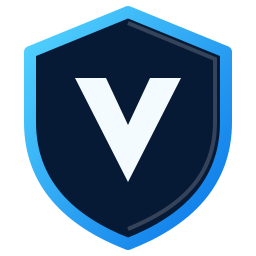

  

<h1 align="center">Vaulton</h1>

<strong>Your files. Your backups. Your server.</strong>

A simple way to manage your files and keep your data protected on a server you control.

  <a href="https://github.com/ericg2/Vaulton-UI/releases">Download the App</a> ·
  <a href="https://github.com/ericg2/Vaulton">Vaulton Server</a> ·
  <a href="https://github.com/ericg2/Vaulton-UI/issues">Get Help</a>

Vaulton gives you one place to browse files, manage backups, keep folders in sync, and check on your server. Your data stays on your own server, and you choose who can access it.

## Getting Started

1. **Set up your server.** Follow the [server setup guide](https://github.com/ericg2/Vaulton/blob/main/docs/SETUP.md). You will need a computer or server that can stay online and a place to store your files.
2. **Start Vaulton.** Once setup is complete, open the app and enter your server address. The default connection uses port `5141`.
3. **Sign in.** Use the account created during server setup. Follow any password-change or security prompts.
4. **Add a storage location.** Open Storage to connect a folder or supported storage service. Then you can browse and manage your files.
5. **Set up a backup.** Create a repository and schedule backups so your important files are protected.

New to Vaulton? Start with the [server setup guide](https://github.com/ericg2/Vaulton/blob/main/docs/SETUP.md), then use the [user guide](https://github.com/ericg2/Vaulton/blob/main/docs/USER_GUIDE.md) for everyday tasks.

## Download

Get the latest version from [Vaulton Releases](https://github.com/ericg2/Vaulton-UI/releases). Choose the download for your device:

- **Windows:** Download and run the Windows installer.
- **Linux:** Download the Linux package and follow the included installation instructions.
- **Android:** Download the APK, open it on your device, and approve installation when prompted.
- **Web:** Host the built web app on a web server. The app connects to your Vaulton server; it is not a standalone file server.

Always download releases from the official repository. The app needs access to a running Vaulton server to sign in and manage your files.

## Connecting to Your Server

On the sign-in screen, enter your server address and port. For most installations, the port is `5141`.

- If the app and server are on the same home network, use the server's local IP address, such as `192.168.1.20`.
- If you are connecting from outside your home, use a secure address that you have configured for remote access.
- Keep the default port unless you changed it during server setup.
- If you cannot connect, check that the server is running and that your network or firewall allows the connection.

Do not expose the server directly to the internet without configuring secure remote access. Use HTTPS through a trusted reverse proxy or VPN for connections outside your local network.

## Features

| Feature | What it helps you do |
|---|---|
| File management | Browse, search, upload, download, move, copy, rename, and preview files. |
| Backups | Create scheduled backups, browse saved snapshots, and restore files or folders. |
| Folder sync | Keep selected folders in sync with a storage location. |
| Storage | Connect storage locations and manage access and quotas. New Data Folders can optionally use the server's experimental encryption feature when it is enabled. |
| Transfers | Track uploads and downloads, retry failed transfers, and view progress. |
| Account security | Use two-factor authentication and scoped API tokens. |
| Server management | Check server health, manage users, review jobs, and view activity when your account has permission. |
| Mobile photo backup | Back up selected photos on Android with configurable conditions. |

Vaulton only shows management features your account is allowed to use. Your server remains in control of access and permissions.

## Helpful Notes

- The app needs a running Vaulton server. It does not store or serve your files by itself.
- On Linux, run `./install-desktop.sh` once from the extracted release bundle to register the app icon and application-menu entry. Relaunch Vaulton from the application menu on Wayland.
- Folder sync needs access to a local folder, so it is available in the installed desktop and mobile apps, not in a web browser.
- Web uploads are best suited to small and medium files because the browser manages the transfer.
- Android background tasks are scheduled by the operating system. Battery-saving settings can delay photo backups and other background work.
- When restoring a folder, Vaulton creates that folder inside the destination you select. A restored file is placed directly in the selected destination.
- If you are unsure what a restore will change, review the **Dry Run** before starting it.

## Need Help?

- Read the [user guide](https://github.com/ericg2/Vaulton/blob/main/docs/USER_GUIDE.md) for help with everyday tasks.
- Read the [administrator guide](https://github.com/ericg2/Vaulton/blob/main/docs/ADMIN_GUIDE.md) if you manage the server.
- If something is not working, check the [troubleshooting guide](https://github.com/ericg2/Vaulton/blob/main/docs/TROUBLESHOOTING.md).
- Report a problem through [GitHub Issues](https://github.com/ericg2/Vaulton-UI/issues).

